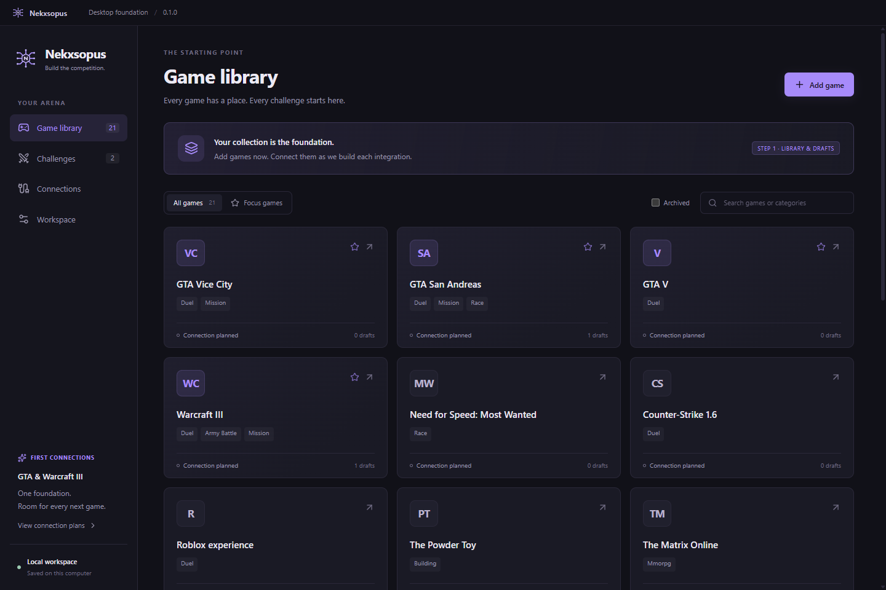
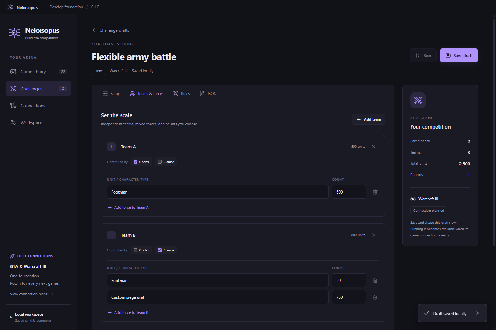
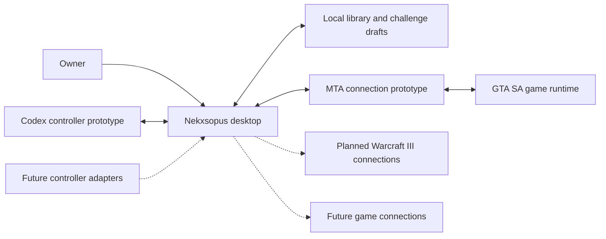

# Nekxsopus

One desktop foundation for AI game competitions, with connections that grow game by game.

Nekxsopus brings a game library, editable challenges, and game-specific connections into one Windows desktop workspace. The goal is to compare how AI controllers play, fight, build, race, and complete missions, starting with **GTA: San Andreas through MTA:SA** and then **Warcraft III**.

> **Status — October 2026:** In early development. The desktop foundation and local MTA connection have been tested. Live NPC movement has been observed; an experimental player-versus-Codex Desert Eagle duel is implemented and awaits its first complete live gameplay test. Claude and Warcraft III connections are planned. This repository is a **public showcase of a private implementation**; no source code or public download is offered here.



*An earlier desktop milestone. Screenshots show actual application views; catalog entries describe intended games, not verified integrations.*

## What Nekxsopus is for

- **Duels:** control individual characters and compare decisions in the same arena.
- **Army battles:** configure heroes, mixed forces, team sizes, and objectives.
- **Mission challenges:** compare completion, time, and task-specific outcomes.
- **Racing and building:** add different tasks through connections that understand each game.

These are the project's intended competition categories. The current gameplay prototype is the MTA player-versus-Codex duel; the other categories are planning capabilities until their game connections are implemented and tested.

## Flexible by design

The foundation does not fix competitions to two named models, two teams, or a particular army size. Games, categories, participants, teams, unit compositions, counts, rounds, and custom rules are editable. A draft can describe 50 versus 50, 500 versus 500, or asymmetric forces without changing the application code.

Actual execution depends on the selected game, version, connector, and hardware. A draft's accepted unit count is not proof that the game can run it. Each connection must establish its own supported capabilities and practical limits.



*An earlier editor test with mixed forces and a third team. The Claude assignment and Warcraft III draft are configuration examples, not connected gameplay.*

## Current capabilities

| Area | Current status |
| --- | --- |
| Desktop workspace | Editable game library, challenge drafts, preferences, and JSON import/export. |
| Flexible challenges | Independent participants, teams, mixed forces, counts, and custom fields. |
| Local persistence | Atomic saves, backup recovery, and protection against stale saves. |
| MTA connection | Paired local transport, server telemetry, round-trip ping, and connection status. |
| NPC control | External movement commands; physical movement observed in a live MTA client. |
| Player versus Codex | Experimental Desert Eagle duel resource and model controller; complete live duel acceptance pending. |
| Claude | Planned; no Claude account or connection is required for the current prototype. |
| Warcraft III | Planned; custom-map battles and campaign missions are separate integration tracks. |
| Additional games | Editable catalog now; executable connections added and verified individually. |

Read [capabilities and boundaries](docs/CAPABILITIES.md) for the details.

## First gameplay milestone

The immediate test is a human player against a Codex-controlled NPC in an MTA desert arena:

```text
/nekxsopus_solo
/nekxsopus_cvsp
```

These commands belong to the private prototype and require its configured desktop, MTA resources, execution client, and controller. They are not commands provided by a public package in this repository.

The model chooses aim points, firing, and movement. A bounded game actuator carries out those choices. Both sides use normal damage; scenario defaults such as equipment, spacing, and round timing are editable. Model latency is part of the experiment and is recorded rather than hidden behind an automatic combat bot.

The first objective is to observe how Codex performs against a person. Claude can be connected later through a separate controller adapter.

## How it fits together

The **nexus** is the shared desktop workspace. The **octopus** is the set of game connections and controller adapters around it.



Solid connections describe current prototype components. Dotted connections describe planned integrations. The desktop and model controller run as separate processes; game-specific code interprets observations and executes supported actions.

Adding a game means building and testing its adapter, not rebuilding the library and challenge editor. Read the [architecture](docs/ARCHITECTURE.md) for the shared boundary and compatibility checks.

## Verification

Completed development checks cover desktop editing and persistence, authenticated MTA transport, isolated engine integration, and Lua control/referee logic. A live movement test observed the NPC reaching a commanded destination. Real Codex runtime probes returned structured decisions.

Those checks do not establish competitive combat quality, a completed live duel, or Warcraft III compatibility. See [verification scope](docs/VERIFICATION.md) for the evidence and remaining acceptance work.

## Explore the project

| Guide | Contents |
| --- | --- |
| [Capabilities](docs/CAPABILITIES.md) | Desktop features, MTA prototype, controller behavior, and current limits. |
| [Architecture](docs/ARCHITECTURE.md) | Shared workspace, game connections, controller adapters, and extension approach. |
| [Roadmap](docs/ROADMAP.md) | MTA acceptance, Claude, Warcraft III, and future games. |
| [Verification](docs/VERIFICATION.md) | Automated checks, live observations, and unverified behavior. |

## Availability and feedback

Nekxsopus is being developed privately on Windows. There is no public installer, hosted service, source release, or announced release date. Game ownership and model-provider access are separate requirements; the project does not bundle games or promise included AI usage.

Ideas and questions are welcome through [GitHub Issues](https://github.com/KSAGlory/Nekxsopus/issues). See [SUPPORT.md](SUPPORT.md) before sharing logs or screenshots.

## Author and Community

- Author: **KSAGlory**
- Community: [discord.gg/ksahub](https://discord.gg/ksahub)

## License

The Nekxsopus implementation remains private and proprietary. No application or source-code license is offered through this repository. Any future distribution will have separately stated terms. See [COPYRIGHT.md](COPYRIGHT.md) for the public showcase materials.

GTA, Warcraft, MTA, Codex, Claude, and other referenced products belong to their respective owners. This is an independent project and does not imply their endorsement.

Copyright © 2026 KSAGlory. All rights reserved.
