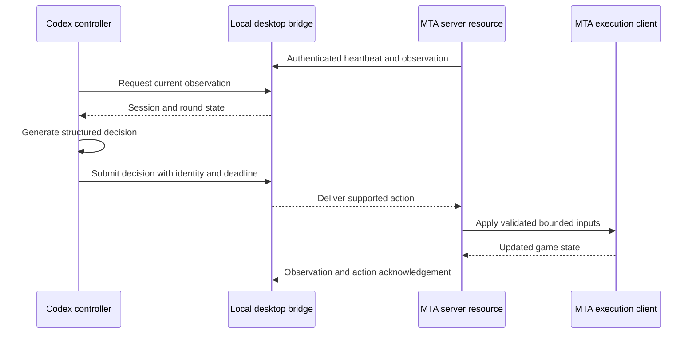

# Architecture

Nekxsopus separates shared competition configuration from game-specific execution and model-specific reasoning. The desktop foundation and MTA prototype exist today. The broader connector contract is an extension design; it is not yet implemented across multiple games.

## Shared desktop workspace: the nexus

The Electron and React desktop maintains games, challenge drafts, preferences, and local storage. TypeScript data models preserve custom fields so new scenario data does not require a new editor for every experiment.

The shared configuration describes participants, teams, mixed forces, rules, and objectives. It does not implement GTA aiming, Warcraft abilities, or racing physics. Game and controller credentials are kept separate from ordinary workspace exports.

The renderer uses a limited IPC interface and does not expose Node.js globals. The host controls filesystem access and the paired local transport.

## Game connections: the octopus

A game adapter translates between the shared challenge and that game's supported observations and actions. Each profile needs an exact runtime target, capabilities, requirements, and verification evidence. Multiple profiles may exist for different versions of the same game.

The intended lifecycle is:

| Operation | Responsibility |
| --- | --- |
| Describe | Report the connector protocol and available capabilities. |
| Probe | Check the selected game profile and explain compatibility failures. |
| Prepare | Create the requested scenario and session. |
| Observe | Return the state visible to a participant. |
| Submit | Validate and apply supported actions. |
| Reset | Start a fresh scenario epoch without accepting old commands. |
| Stop | End control and clean up resources owned by the connection. |

The common contract includes session, round, epoch, observation, participant, deadline, and idempotency identifiers. The current MTA transport has its own implemented action envelope; convergence on the complete shared lifecycle remains future work.

## Controller adapters

A controller consumes observations and returns decisions. The game adapter executes those decisions and measures the result. This separates a model's choices from the motor code required to move a character or issue an order.

The Codex prototype runs as a separate process using a persistent runtime. Claude and other providers would implement their own adapters rather than changing the game library or embedding provider-specific behavior in every game resource.

Decision time, stale observations, rejected commands, and exhausted per-round budgets must remain visible. If a model call fails, the current prototype does not substitute a scripted combat policy and label it a model decision.

## MTA reference implementation

Desktop and MTA server currently run on the same machine, with the listener bound to loopback. The server validates actions and referees the round; a streaming MTA client performs the character controls. An acknowledgement means an action was accepted. Later physical observations establish whether it achieved its destination or objective.

The first duel is deliberately narrow: one human and one NPC. This scenario does not limit the shared participant, team, or force data model.

## Adding another game

1. Identify the owned game edition and runtime, and a usable mod, map, plugin, or supported control channel.
2. Establish what state can be observed and which actions can actually be executed.
3. Implement a profile with explicit compatibility checks and limits.
4. Demonstrate preparation, observation, one action, reset, and cleanup in isolation.
5. Connect a controller and complete a small live task before expanding scenario scope.
6. Record supported versions, practical limits, and acceptance evidence.

This makes extension repeatable without promising that every game exposes the same capabilities. Engine limits, absent APIs, campaigns with custom scripts, and runtime differences still require game-specific work.

## Fair comparisons

The planned competition layer should record the scenario configuration, controller/model identity, observation permissions, decision timing, command outcomes, and game results. Shared-world duels and separately repeated missions require different reset and scoring rules.

These comparison facilities are a design direction, not an existing tournament service or a validated benchmark. The next priority is completing the first live MTA duel before automating multi-model comparisons.
