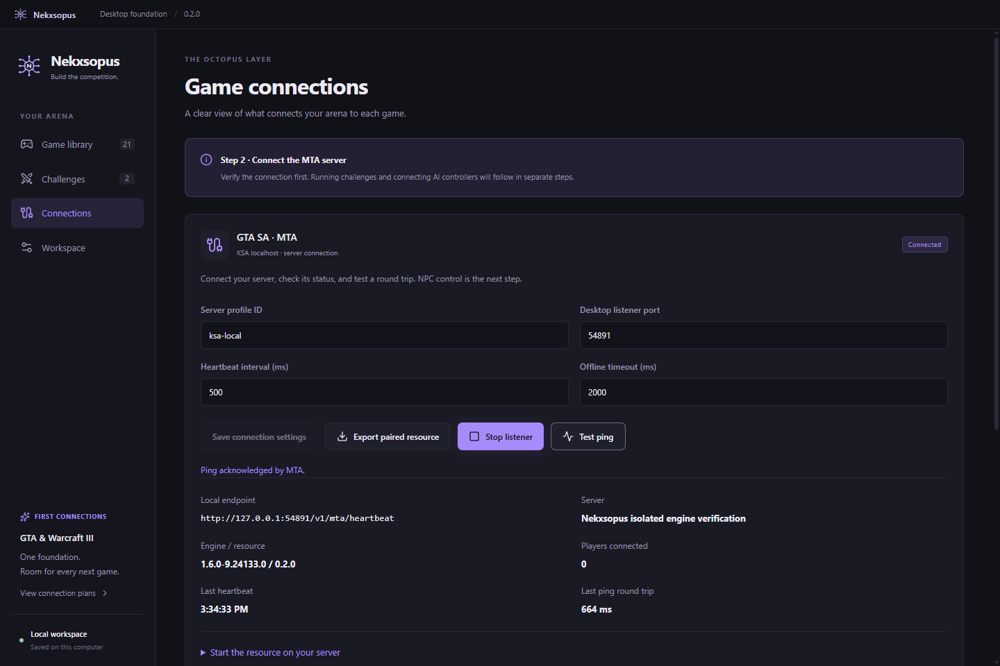

# Capabilities and boundaries

Status recorded on 15 October 2026. This page describes the private development build, not publicly downloadable software.

## Desktop foundation

The Windows desktop application provides an editable game library and challenge drafts. The starter catalog has 21 games; it is a planning list, not a list of supported integrations.

Owners can edit game names, categories, priorities, versions, executable paths, and notes. Challenge drafts contain participants, team assignments, mixed forces, independent counts, rounds, timing, scenario fields, and custom rules. Advanced JSON fields are preserved rather than discarded when saving through the editor.

Workspace preferences and drafts persist locally. Saves use an atomic replacement and retain a previous successful backup. The store checks revisions to avoid overwriting a newer save and can recover from a corrupt primary file while preserving it for inspection. Workspace JSON import/export is separate from private connection credentials.

Recording a game executable path does not launch the game or verify compatibility. There is no general-purpose match runner for every catalog entry.

## MTA connection

The current bridge connects a local MTA:SA server to the desktop on the same computer. It provides authenticated telemetry, connection status, round-trip ping, and supported NPC actions. A paired server-only resource holds the game-side credential; the game client does not receive that credential.

The transport checks protocol and session identity, message size, sequencing, deadlines, and duplicate actions. It accepts explicit actions rather than arbitrary Lua or remote-console execution. Physical NPC control requires a connected MTA client that streams the relevant arena.

*Captured during an earlier isolated engine test. The displayed loopback port and server label are test values, not public connection details.*

## Player versus Codex prototype

The current scenario creates a single NPC in a private desert arena. The human controls their normal player; an external Codex controller supplies decisions for the NPC.

| Command | Prototype behavior |
| --- | --- |
| `/nekxsopus_solo` | Open the arena and create the NPC. |
| `/nekxsopus_cvsp` | Prepare the Desert Eagle duel, wait for a model decision, then count down. |
| `/nekxsopus_reset` | Create a fresh NPC. |
| `/nekxsopus_leave` | End the session, clean up, and restore the saved player state. |

The private prototype requires a logged-in MTA administrator and its separately configured resources and controller. These commands cannot be installed from this showcase.

The duel defaults are a Desert Eagle, 70 rounds of ammunition, 100 health, no armour, and 20 metres of separation. These are editable scenario defaults, not application-wide rules. Both sides take normal damage. Rounds end on death, timeout, exit, or transport failure; the game's referee determines the outcome.

Model output selects a fixed world aim point, fire state, strafe direction, forward/backward direction, and input duration. The actuator executes those inputs and stops expired or invalid commands. It does not automatically follow the opponent with its aim. The controller's game observations omit hidden opponent health and provide opponent aim points only when visible.

The controller uses a persistent signed-in Codex runtime and structured output. Real decisions were obtained with the model configured for that development environment. This does not promise that every account offers the same model or allowances. The controller process is separate from the assistant conversation that develops Nekxsopus.

The first complete live duel is still pending. Timing and decision logs support later analysis; no combat ranking or performance claim has been established.

## Planned scope

Claude will use a separate controller adapter. Participant labels in a draft do not connect a provider or create an authenticated model session.

Warcraft III is a priority for both custom-map battles and campaigns. They need separate compatibility and gameplay checks. Owning a legacy key with The Frozen Throne does not establish the installed executable version or guarantee compatibility with a particular bridge.

Other candidate games include GTA III, Vice City, GTA V, racing games, shooters, building games, and platformers. A game enters the verified support list only after a usable control/observation channel and live acceptance checks exist.
